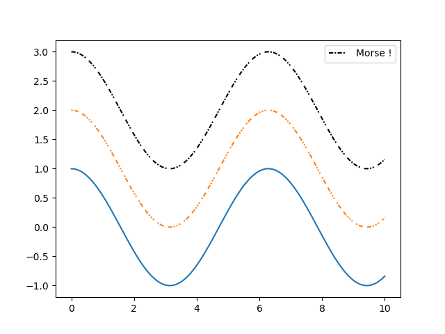
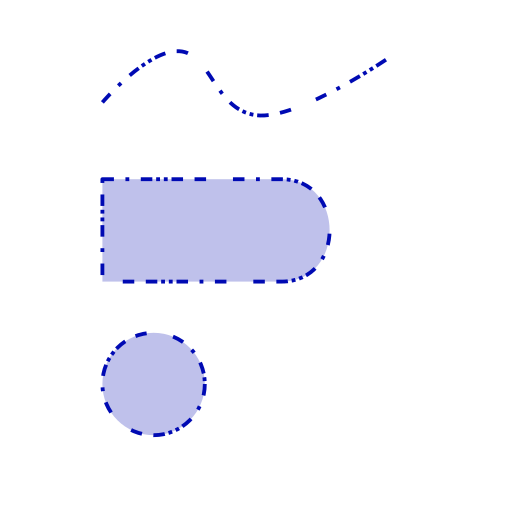

# morse_plot

The goal of this project is to make it possible to plot data, or draw lines, with dashes that represent text encoded in Morse in various software and programming languages.


## Currently supported

For now, the following programming languages and software are currently supported:
- Python + Matplotlib, via the `morseplot` package (in the `./python` folder). For now, only plotting lines is supported. See the [Morseplot Python package](#morseplot-python-package) section for more details.
- Inkscape (requires Python 3). See the [Inkscape strokes](#inkscape-trokes) section.

Other languages _might_ be added later on (MATLAB, R, js, … ?).


## Why ?

It can be useful for people that feel like the usual selection of line styles or dashes pattern is too limited.
Or for people that feel that including legends in graphs is overrated: now, the graph can be self-describing !


But in the end, it's mostly for fun !


## How to and examples

### Morseplot Python package

This Python module expands Matplotlib with a new `morse_plot()` function.
The `morse_plot` function takes two extra arguments compared to `plot()`: `morse_text` and `morse_durations` which is optional, but can be used to adjust the lengths of the dots, dashes and pauses.
Since `morse_plot()` is a wrapper around the `plot()` function from Matplotlib, all of the args from`plot()` can be used (eg. `color`, `linewidth`, ...)


To use this package, you only need to copy the `morseplot` folder (located in this repo's `python` folder) and paste it into your working directory. Then, in your Python code, simply add `import morseplot.morse_plot` after importing Matplotlib and you're done.

The code below (taken from `./python/morse_plot_example.py`) shows a simple example:
```python
# The usual imports
import numpy as np
import matplotlib.pyplot as plt

# This import adds the `morse_plot` function to Matplotlib
# Nothing more to do !
import morseplot.morse_plot

# Create some data to plot
x = np.linspace(0, 10, 1000)
y = np.cos(x)

# The usual plot
plt.plot(x, y)

# Plot with some morse code
plt.morse_plot(x, y+1, morse_text='AB')

# We can also do it from the axis !
# Get the axis
ax = plt.gca()
# Plot with a different label and some color
ax.morse_plot(x, y+2, morse_text='CD', label='Morse !', color='k') 

plt.legend()
```
And here is the result:


> [!WARNING]
> Text with more than 5 characters does not work properly.

> [!NOTE]
> For now, only plotting lines is supported. Patches and contours _might_ be added later on.


### Inkscape strokes

With the script `inkscape_dashes.py`, it is possible to generate the dash patterns necessary to encode Morse in strokes as shown below.
Note that this requires a working Python 3 install.



How to:
1. Download and copy the `python` folder in this repo.
2. Go inside the `python` folder.
3. Execute the `inkscape_dashes.py` script from the command line with either `python3 ./inkscape_dashes.py some_text` or (on Linux) simply with `./inkscape_dashes some_text`. For example:
    ```
    >> python3 ./inkscape_dashes.py "text "
    Inkscape dashes pattern for "text ":
    3 3 1 3 3 1 1 1 1 1 3 3 3 7
    ```
5. Copy the second line (the ones starting with `3 3 ...` )
6. In Inkscape, select the chosen path or shape, and go to the "Fill and Stroke" tab, and then "Stroke Style" subtab.
7. In "Dashes", select "Custom". A new line called "Pattern" should appear.
8. Paste the dash pattern generated above in the "Pattern" field in Inkscape.

> [!NOTE]
> - It is best to enclose you text inside of quotes, especially if you have spaces.
> - In the example above, we added an extra space at the end to make it look nicer.
> - Other options can be shown with `--help`.


## Known limitations

- Currently only letters and numbers are supported. Punctuation and prosigns (SOS, SK, ...) support should be added soon.
- Morseplot Python package:
    - For now, only plotting lines is supported. Patches and contour _might_ be added later on.
    - Morse text is limited to 5 characters.
    - The line in the legend might be too short to show the whole Morse text.


## License

This project is licensed under the BSD 3-Clause License.


## Disclaimer

This is an independent project. It is not endorsed by Matplotlib, Inkscape, ...
